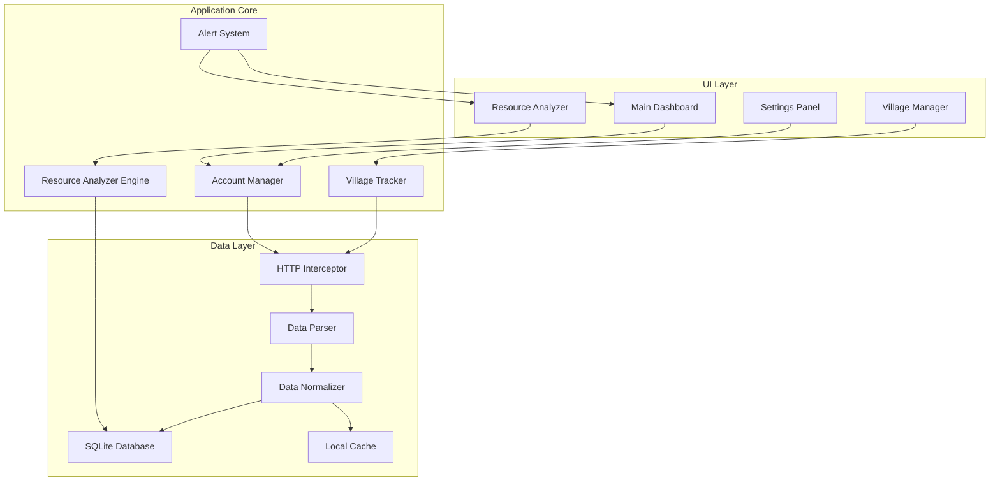
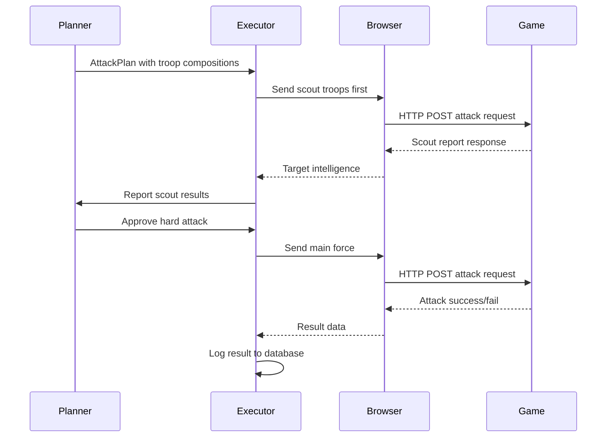
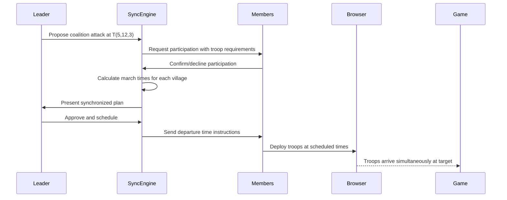
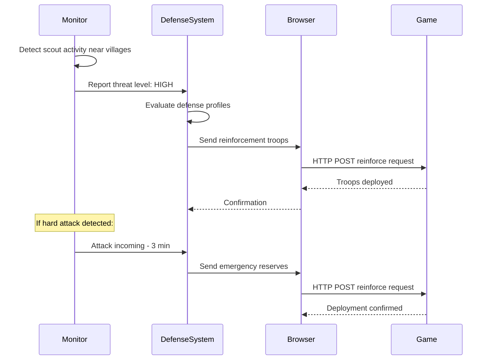
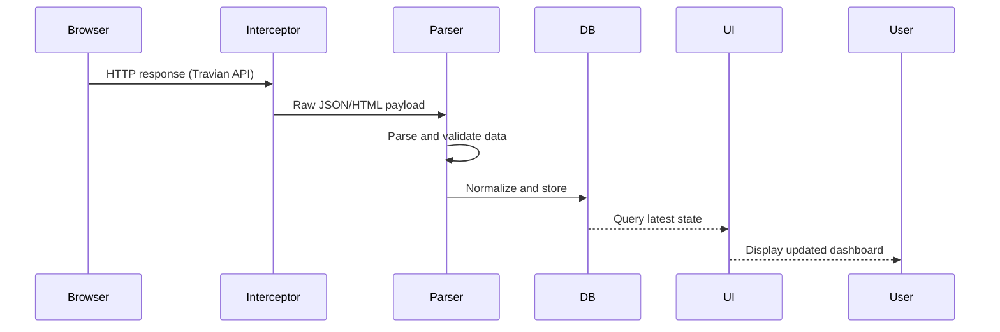

# Travian Kingdoms Assistant - Architecture Plan

## 1. Project Overview

**Goal:** Desktop application with GUI for managing and tracking progress in Travian Kingdoms, focused on village management and resource analysis.

**Tech Stack:**
- **Language:** Python 3.12+
- **GUI Framework:** PySide6 (Qt for Python)
- **HTTP Interception:** Custom module using `mitmproxy` or browser CDP (Chrome DevTools Protocol)
- **Database:** SQLite with SQLAlchemy ORM
- **Data Analysis:** pandas (optional, for resource trends)

---

## 2. System Architecture



---

## 3. Module Breakdown

### 3.1 HTTP Interception Module (`src/interceptor/`)

**Purpose:** Capture game data from browser traffic.

**Approach Options:**
- **Option A (Recommended):** Browser CDP - Connect to running Chrome instance, intercept network requests
- **Option B:** mitmproxy addon - Run local proxy that captures and filters Travian requests
- **Option C:** Network monitoring with `pyshark`/scapy for packet capture

**Data Flow:**
```
Browser -> HTTP Interceptor -> Request Filter -> Response Parser -> Raw JSON/HTML
```

**Key Responsibilities:**
- Connect to browser via CDP endpoint
- Subscribe to network events
- Filter Travian API calls (game.traviangames.com endpoints)
- Capture responses containing village data, resources, troop info
- Forward parsed data to normalization layer

---

### 3.2 Data Parsing Layer (`src/parsing/`)

**Purpose:** Transform raw game responses into structured Python objects.

**Travian Kingdoms API Endpoints (expected):**
- `world.php` - World/server information
- `field.php` - Field data
- `village.php` - Village details (resources, buildings, troops)
- `overview.php` - Village overview list
- `buildings.php` - Building status
- `statistics.php` - Player statistics

**Parser Components:**
- `response_parser.py` - HTTP response parsing utilities
- `field_parser.py` - Field/coord data extraction
- `village_parser.py` - Village state extraction
- `troop_parser.py` - Military unit tracking
- `building_parser.py` - Building levels and construction

---

### 3.3 Core Data Models (`src/models/`)

```python
# Core entities:

class Account:
    account_id: str
    username: str
    world: str
    server: str
    alliance: str | None
    created_at: datetime
    last_login: datetime

class Village:
    village_id: str
    account_id: str
    name: str
    coordinates: tuple(int, int, int)  # row, col, field number
    population: int
    farm_level: int
    wood: ResourcePoint
    clay: ResourcePoint
    iron: ResourcePoint
    chief_level: int
    temple_level: int
    building_queue: BuildingQueue | None

class ResourcePoint:
    type: str  # wood, clay, iron, grain
    current_amount: int
    max_capacity: int
    production_rate: float  # per hour
    last_updated: datetime

class TroopUnit:
    unit_type: str  # spear, sword, axe, scout, snipper
    count: int
    training_time_remaining: timedelta | None
    stationed_at: str  # village_id or barracks_id

class BuildingQueue:
    building_id: str
    building_type: str
    start_time: datetime
    completion_time: datetime
    upgrade_level: int

class AttackLog:
    attack_id: str
    attacker_village: str
    target_village: str
    timestamp: datetime
    outcome: str  # win, loss, draw
    resources_looted: int
```

---

### 3.4 Database Layer (`src/database/`)

**ORM:** SQLAlchemy with SQLite

**Schema Design:**
```sql
-- accounts table
CREATE TABLE accounts (
    id INTEGER PRIMARY KEY AUTOINCREMENT,
    account_id TEXT UNIQUE NOT NULL,
    username TEXT NOT NULL,
    world TEXT NOT NULL,
    server TEXT NOT NULL,
    alliance TEXT,
    created_at TIMESTAMP DEFAULT CURRENT_TIMESTAMP,
    last_login TIMESTAMP
);

-- villages table
CREATE TABLE villages (
    id INTEGER PRIMARY KEY AUTOINCREMENT,
    account_id INTEGER REFERENCES accounts(id),
    village_id TEXT UNIQUE NOT NULL,
    name TEXT,
    coordinates TEXT NOT NULL,  -- JSON: {row, col, field}
    population INTEGER DEFAULT 0,
    farm_level INTEGER DEFAULT 0,
    chief_level INTEGER DEFAULT 0,
    temple_level INTEGER DEFAULT 0,
    created_at TIMESTAMP DEFAULT CURRENT_TIMESTAMP,
    updated_at TIMESTAMP
);

-- resources table (time-series data)
CREATE TABLE resources (
    id INTEGER PRIMARY KEY AUTOINCREMENT,
    village_id INTEGER REFERENCES villages(id),
    resource_type TEXT NOT NULL CHECK(resource_type IN ('wood', 'clay', 'iron', 'grain')),
    current_amount INTEGER NOT NULL,
    max_capacity INTEGER NOT NULL,
    production_rate REAL NOT NULL,
    recorded_at TIMESTAMP DEFAULT CURRENT_TIMESTAMP
);

-- troops table
CREATE TABLE troops (
    id INTEGER PRIMARY KEY AUTOINCREMENT,
    village_id INTEGER REFERENCES villages(id),
    unit_type TEXT NOT NULL,
    count INTEGER DEFAULT 0,
    training_start TIMESTAMP,
    training_end TIMESTAMP,
    recorded_at TIMESTAMP DEFAULT CURRENT_TIMESTAMP
);

-- building_queue table
CREATE TABLE building_queue (
    id INTEGER PRIMARY KEY AUTOINCREMENT,
    village_id INTEGER REFERENCES villages(id),
    building_type TEXT NOT NULL,
    target_level INTEGER,
    start_time TIMESTAMP,
    completion_time TIMESTAMP,
    completed_at TIMESTAMP,
    is_active BOOLEAN DEFAULT 1
);

-- attack_logs table
CREATE TABLE attack_logs (
    id INTEGER PRIMARY KEY AUTOINCREMENT,
    attacker_village_id TEXT,
    target_village_id TEXT,
    timestamp TIMESTAMP DEFAULT CURRENT_TIMESTAMP,
    outcome TEXT NOT NULL,
    resources_looted INTEGER DEFAULT 0,
    notes TEXT
);

-- attack_plans table (for automation)
CREATE TABLE attack_plans (
    id INTEGER PRIMARY KEY AUTOINCREMENT,
    plan_id TEXT UNIQUE NOT NULL,
    target_village_id TEXT NOT NULL,
    target_coordinates TEXT NOT NULL,  -- JSON: {row, col, field}
    attack_type TEXT NOT NULL CHECK(attack_type IN ('scout', 'hard_attack', 'snip', 'coalition')),
    status TEXT DEFAULT 'pending' CHECK(status IN ('pending', 'scheduled', 'executing', 'success', 'failed', 'cancelled')),
    planned_at TIMESTAMP,
    executed_at TIMESTAMP,
    created_by_strategy TEXT  -- strategy_id if auto-generated
);

-- attack_plan_troops table (troop compositions per attack)
CREATE TABLE attack_plan_troops (
    id INTEGER PRIMARY KEY AUTOINCREMENT,
    attack_plan_id INTEGER REFERENCES attack_plans(id),
    village_id TEXT NOT NULL,  -- sending village
    troop_composition TEXT NOT NULL,  -- JSON: {"spear": 100, "sword": 50, ...}
    march_time_seconds REAL,
    is_primary_force BOOLEAN DEFAULT 0
);

-- attack_schedules table
CREATE TABLE attack_schedules (
    id INTEGER PRIMARY KEY AUTOINCREMENT,
    schedule_id TEXT UNIQUE NOT NULL,
    name TEXT NOT NULL,
    trigger_type TEXT NOT NULL CHECK(trigger_type IN ('time_based', 'event_based', 'manual')),
    cron_expression TEXT,
    target_filter TEXT NOT NULL,  -- JSON: {min_distance, max_distance, min_resources, ...}
    troop_template TEXT NOT NULL,  -- JSON: default troop composition
    cooldown_minutes INTEGER DEFAULT 30,
    max_attacks_per_day INTEGER DEFAULT 10,
    is_active BOOLEAN DEFAULT 0,
    created_at TIMESTAMP DEFAULT CURRENT_TIMESTAMP
);

-- attack_strategies table
CREATE TABLE attack_strategies (
    id INTEGER PRIMARY KEY AUTOINCREMENT,
    strategy_id TEXT UNIQUE NOT NULL,
    name TEXT NOT NULL,
    rules JSON,  -- Array of rule definitions
    is_active BOOLEAN DEFAULT 0,
    created_at TIMESTAMP DEFAULT CURRENT_TIMESTAMP
);

-- scout_reports table
CREATE TABLE scout_reports (
    id INTEGER PRIMARY KEY AUTOINCREMENT,
    target_village_id TEXT NOT NULL,
    target_coordinates TEXT NOT NULL,
    target_alliance TEXT,
    village_name TEXT,
    reported_troops TEXT NOT NULL,  -- JSON: {"spear": 50, "sword": 30, ...}
    total_military INTEGER,
    barracks_level INTEGER,
    training_camp_level INTEGER,
    wall_level INTEGER,
    warehouse_level INTEGER,
    collected_at TIMESTAMP DEFAULT CURRENT_TIMESTAMP
);

-- automation_logs table (for audit trail)
CREATE TABLE automation_logs (
    id INTEGER PRIMARY KEY AUTOINCREMENT,
    action_type TEXT NOT NULL CHECK(action_type IN ('attack', 'collect', 'train', 'build')),
    action_name TEXT NOT NULL,
    village_id TEXT,
    target_id TEXT,  -- could be coordinate or village_id
    details JSON,  -- Additional context about the action
    timestamp TIMESTAMP DEFAULT CURRENT_TIMESTAMP,
    status TEXT DEFAULT 'pending' CHECK(status IN ('pending', 'success', 'failed'))
);

-- alliance_members table (coalition tracking)
CREATE TABLE alliance_members (
    id INTEGER PRIMARY KEY AUTOINCREMENT,
    account_id INTEGER REFERENCES accounts(id),
    member_name TEXT NOT NULL,
    world TEXT NOT NULL,
    villages JSON NOT NULL,  -- Array of village_ids belonging to member
    role TEXT DEFAULT 'member' CHECK(role IN ('leader', 'officer', 'member')),
    joined_at TIMESTAMP DEFAULT CURRENT_TIMESTAMP,
    is_active BOOLEAN DEFAULT 1
);

-- coalition_attacks table (coalition attack planning)
CREATE TABLE coalition_attacks (
    id INTEGER PRIMARY KEY AUTOINCREMENT,
    coalition_id TEXT NOT NULL,
    plan_id INTEGER REFERENCES attack_plans(id),
    target_village_id TEXT NOT NULL,
    target_coordinates TEXT NOT NULL,
    attack_type TEXT NOT NULL CHECK(attack_type IN ('scout', 'hard_attack', 'snip', 'raid')),
    status TEXT DEFAULT 'planning' CHECK(status IN ('planning', 'scheduled', 'executing', 'success', 'failed', 'cancelled')),
    scheduled_march_time TIMESTAMP,
    max_variance_seconds INTEGER DEFAULT 30,  -- Allow troops to arrive within this window
    created_by_account_id INTEGER REFERENCES accounts(id),
    created_at TIMESTAMP DEFAULT CURRENT_TIMESTAMP,
    executed_at TIMESTAMP
);

-- coalition_participants table (which villages participate)
CREATE TABLE coalition_participants (
    id INTEGER PRIMARY KEY AUTOINCREMENT,
    coalition_attack_id INTEGER REFERENCES coalition_attacks(id),
    member_account_id INTEGER REFERENCES alliance_members(id),
    participant_village_id TEXT NOT NULL,
    troop_composition TEXT NOT NULL,  -- JSON: {"spear": 100, "sword": 50}
    march_time_seconds REAL,
    is_confirmed BOOLEAN DEFAULT 0,
    confirmed_at TIMESTAMP
);

-- coalition_messages table (coordination communication)
CREATE TABLE coalition_messages (
    id INTEGER PRIMARY KEY AUTOINCREMENT,
    coalition_id TEXT NOT NULL,
    sender_account_id INTEGER REFERENCES accounts(id),
    message_type TEXT NOT NULL CHECK(message_type IN ('attack_proposal', 'confirmation', 'cancel', 'status_update', 'general')),
    payload JSON,  -- Attack details, timestamps, etc.
    timestamp TIMESTAMP DEFAULT CURRENT_TIMESTAMP
);

-- coalition_strategies table (alliance-wide attack strategies)
CREATE TABLE coalition_strategies (
    id INTEGER PRIMARY KEY AUTOINCREMENT,
    strategy_id TEXT UNIQUE NOT NULL,
    name TEXT NOT NULL,
    description TEXT,
    target_filter JSON NOT NULL,  -- {min_distance, max_distance, min_resources, ...}
    troop_template JSON NOT NULL,  -- Default coalition troop composition
    alliance_name TEXT NOT NULL,
    is_active BOOLEAN DEFAULT 0,
    created_at TIMESTAMP DEFAULT CURRENT_TIMESTAMP
);

-- defense_profiles table (automated defense strategies)
CREATE TABLE defense_profiles (
    id INTEGER PRIMARY KEY AUTOINCREMENT,
    village_id TEXT NOT NULL,
    profile_id TEXT NOT NULL,
    name TEXT NOT NULL,
    defensive_troops JSON NOT NULL,  -- {"spear": 500, "shield": 200}
    wall_upgrade_priority TEXT DEFAULT 'medium' CHECK(wall_upgrade_priority IN ('high', 'medium', 'low')),
    wonder_activation_threshold INTEGER DEFAULT 50000,
    is_active BOOLEAN DEFAULT 0,
    created_at TIMESTAMP DEFAULT CURRENT_TIMESTAMP
);

-- reinforcement_rules table (when to send troops)
CREATE TABLE reinforcement_rules (
    id INTEGER PRIMARY KEY AUTOINCREMENT,
    defense_profile_id INTEGER REFERENCES defense_profiles(id),
    trigger_condition TEXT NOT NULL CHECK(trigger_condition IN ('attack_detected', 'scout_detected', 'threat_level_high', 'coalition_targeted')),
    source_villages JSON NOT NULL,  -- Array of village_ids sending reinforcements
    max_troops_to_send INTEGER DEFAULT 1000,
    priority_units JSON NOT NULL,  -- ["spear", "shield"] - defense bonus units
    is_active BOOLEAN DEFAULT 1
);

-- threat_logs table (detected threats)
CREATE TABLE threat_logs (
    id INTEGER PRIMARY KEY AUTOINCREMENT,
    source_village_id TEXT,
    target_village_id TEXT,
    threat_type TEXT NOT NULL CHECK(threat_type IN ('scout_detected', 'attack_prep', 'hard_attack', 'coalition_target')),
    threat_level TEXT NOT NULL CHECK(threat_level IN ('low', 'medium', 'high', 'critical')),
    confidence_score REAL DEFAULT 0.5,  -- 0-1 probability of actual attack
    predicted_arrival TIMESTAMP,
    detected_at TIMESTAMP DEFAULT CURRENT_TIMESTAMP,
    resolved BOOLEAN DEFAULT 0
);

-- wall_upgrade_queue table (automated wall building)
CREATE TABLE wall_upgrade_queue (
    id INTEGER PRIMARY KEY AUTOINCREMENT,
    village_id TEXT NOT NULL,
    target_wall_level INTEGER NOT NULL,
    queue_position INTEGER DEFAULT 0,
    estimated_completion TIMESTAMP,
    start_time TIMESTAMP,
    completion_time TIMESTAMP,
    status TEXT DEFAULT 'queued' CHECK(status IN ('queued', 'building', 'completed', 'cancelled')),
    created_at TIMESTAMP DEFAULT CURRENT_TIMESTAMP
);

-- scout_detection_logs table (enemy reconnaissance tracking)
CREATE TABLE scout_detection_logs (
    id INTEGER PRIMARY KEY AUTOINCREMENT,
    detected_village_id TEXT NOT NULL,
    attacker_village_id TEXT NOT NULL,  -- where scouts came from
    scout_count INTEGER DEFAULT 0,
    scout_types JSON,  -- {"scout": 50}
    detection_time TIMESTAMP DEFAULT CURRENT_TIMESTAMP,
    pattern_analysis JSON  -- scouting patterns for prediction
);

-- protection_usage_logs table (Wonder of the World tracking)
CREATE TABLE protection_usage_logs (
    id INTEGER PRIMARY KEY AUTOINCREMENT,
    village_id TEXT NOT NULL,
    activated_at TIMESTAMP DEFAULT CURRENT_TIMESTAMP,
    deactivated_at TIMESTAMP,
    reason TEXT NOT NULL CHECK(reason IN ('manual', 'auto_threat', 'auto_resource', 'coalition_defense')),
    is_active BOOLEAN DEFAULT 1
);
```

---

### 3.5 Dashboard UI (`src/ui/dashboard/`)

**Main Window Components:**

```
┌─────────────────────────────────────────────────────────┐
│  MENU BAR: File | Account | View | Tools | Help         │
├─────────────────────────────────────────────────────────┤
│  SIDEBAR                                              │ CONTENT AREA          │
│  ┌────────────────────┐                                │ ┌──────────────────┐│
│  │ 📊 Dashboard       │                                │ │ Village Selector ││
│  │ 🏘️ Villages       │◄── Active village selected     │ │ [Village List]   ││
│  │ ⚔️ Attacks        │                                │ │ ─────────────────││
│  │ 🛡️ Defense        │                                │ │ Resources Chart  ││
│  │ 🤖 Automation     │◄── Attack schedules            │ │ ─────────────────││
│  │ 📈 Statistics      │                                │ │ Building Queue   ││
│  │ ⚙️ Settings        │                                │ │ ─────────────────││
│  └────────────────────┘                                │ │ Troop Status     ││
│                                                       │ │ ─────────────────││
│                                                       │ │ Quick Actions    ││
│                                                       │ │ [Collect] [Train]││
└───────────────────────────────────────────────────────┘
```

**Dashboard Widgets:**
- Resource overview cards (wood, clay, iron, grain) with production rates
- Building progress bars with countdown timers
- Troop training status indicators
- Quick action buttons (collect resources, train troops - if automation enabled)
- Recent activity feed (attacks, building completions)

---

### 3.6 Village Manager (`src/ui/village_manager/`)

**Features:**
- List all villages with key stats
- Click to view detailed village state
- Track resource production over time
- Monitor building queues
- View troop deployment and training
- Coordinate tracking (row, col, field)

---

### 3.7 Attack Automation UI (`src/ui/attack_panel/`) ⭐ NEW

**Features:**
- **Attack Strategy Editor** - Create and manage attack strategies with visual rule builder
- **Schedule Manager** - View and edit attack schedules with calendar widget
- **Live Attack Monitor** - Real-time status of active attacks with progress indicators
- **Scout Report Viewer** - Browse collected intelligence on nearby villages
- **Automation Control Panel** - Start/stop automation, emergency stop button

```
┌─────────────────────────────────────────────────────────┐
│  AUTOMATION CONTROL PANEL                               │
├──────────────┬──────────────────────────────────────────┤
│              │ Attack Overview                          │
│ Controls     │ ┌────────────────────────────────────┐   │
│ ┌──────────┐ │ │ Active Attacks (2)                 │   │
│ │ ▶ Start  │ │ │ [1] Hard Attack -> T(5,12,3)      │   │
│ │ ⏸ Pause  │ │ │    Status: Marching - 2m 14s left  │   │
│ │ ■ Stop   │ │ │    Troops: 150 spear, 200 sword     │   │
│ └──────────┘ │ │ [2] Scout -> T(7,8,2)               │   │
│              │ │    Status: Waiting for return       │   │
│ Strategy     │ │    Troops: 50 scout                 │   │
│ ┌──────────┐ │ └────────────────────────────────────┘   │
│ │ + New    │ │                                          │
│ │ ▼ Active │ │ ┌────────────────────────────────────┐   │
│ └──────────┘ │ │ Quick Attack Actions                 │   │
│              │ │ [Scout Nearby] [Collect Loot]       │   │
│ Schedule     │ │ [Anti-Scout] [Retreat Troops]       │   │
│ ┌──────────┐ │ └────────────────────────────────────┘   │
│ │ Daily 08 │ │                                          │
│ │ Hourly   │ │ ┌────────────────────────────────────┐   │
│ └──────────┘ │ │ Automation Log                       │   │
│              │ │ [14:32] Attack executed -> T(5,12,3)│   │
│ Emergency    │ │ [14:28] Scout returned from T(7,8,2)│   │
│ ┌──────────┐ │ │ [14:15] Troops trained in V(2,4,7)  │   │
│ │ 🚨 STOP  │ │ └────────────────────────────────────┘   │
│ └──────────┘ │                                          │
└──────────────┴──────────────────────────────────────────┘
```

---

### 3.8 Defense Coordinator UI (`src/ui/defense_panel/`) ⭐ NEW

**Features:**
- **Defensive Troop Coordination** - Manage troops across villages for defense
- **Reinforcement Planning** - Calculate optimal reinforcement routes
- **Scout Alert System** - Notify when enemy scouts are detected in your villages
- **Wall & Defense Building Monitor** - Track defensive structure levels

---

### 3.7 Resource Analyzer (`src/analyzer/`)

**Analysis Features:**
- Resource production trends (line charts via matplotlib integration)
- Farm level optimization calculator
- Resource balance recommendations
- Construction time predictions
- Troop training cost analysis
- Attack profitability calculator

---

### 3.8 Account Manager (`src/account/`)

**Features:**
- Multi-account support
- Account switching in UI
- Server/world information display
- Alliance management
- Login tracking

---

### 3.9 Attack Automation Module (`src/automation/attack/`) ⭐ NEW

**Purpose:** Plan, execute, and track automated attacks with smart targeting and troop deployment optimization.

#### 3.9.1 Attack Planner (`src/automation/attack/planner.py`)

**Features:**
- **Target Discovery** - Scan nearby villages for attackable targets based on:
  - Resource storage levels (prioritize high-storage villages)
  - Military capacity (avoid targets with strong defense)
  - Troop composition analysis (identify weak points)
  - Protection status (check for Wonders of the World active)
- **Troop Composition Calculator** - Compute optimal army for each target:
  - Scout-based attacks (low loss ratio, fast return)
  - Hard attack compositions (spear vs sword, sword vs axe, axe vs spear)
  - Snipper compositions for resource collection
  - Coalition attack coordination (multiple villages attacking one target)
- **Path Planning** - Calculate optimal routes:
  - Shortest path calculation using coordinate distance
  - Speed penalty calculations based on troop travel speeds
  - Multiple route options with different trade-offs

```python
class AttackPlan:
    plan_id: str
    attacker_villages: list[str]  # village_ids sending troops
    target_village: str
    target_coordinates: tuple(int, int, int)
    troop_compositions: dict[str, TroopComposition]  # village_id -> composition
    estimated_march_time: timedelta
    estimated_return_time: timedelta
    expected_loot: int
    expected_losses: int
    attack_type: str  # scout, hard_attack, snip, coalition
    status: str  # pending, scheduled, executed, failed, success
    
class TroopComposition:
    units: dict[str, int]  # unit_type -> count
    total_march_time: timedelta
    arrival_variance: float  # seconds (accounts for different troop speeds)
    
class AttackStrategy:
    strategy_id: str
    name: str
    rules: list[AttackRule]
    enabled: bool
    
class AttackRule:
    rule_type: str  # resource_threshold, military_ratio, proximity, schedule
    conditions: dict  # condition parameters
    action: dict  # response when conditions met
```

#### 3.9.2 Attack Executor (`src/automation/attack/executor.py`)

**Features:**
- **Troop Deployment Automation**:
  - Send troops from designated villages to attack coordinates
  - Handle assembly points (buildings for troop concentration)
  - Manage marching orders and queue management
- **Scout-and-Strike Workflow**:
  - Send scouts first to gather target intelligence
  - Analyze scout reports (troop counts, building levels)
  - Launch follow-up attacks based on scout data
- **Multi-wave Attack Execution**:
  - Coordinate simultaneous attacks from multiple villages
  - Staggered waves for sustained pressure
  - Retreat and reorganize between waves

**Execution Flow:**


#### 3.9.3 Attack Scheduler (`src/automation/attack/scheduler.py`)

**Features:**
- Time-based attack scheduling (execute at specific times)
- Event-triggered attacks (respond to scout reports, resource spikes)
- Cooldown management between attacks (prevent banning patterns)
- Daily/weekly attack pattern templates

```python
class AttackSchedule:
    schedule_id: str
    name: str
    trigger_type: str  # time_based, event_based, manual
    cron_expression: str  # e.g., "0 */4 * * *" for every 4 hours
    active_villages: list[str]
    target_filter: TargetFilter
    troop_template: TroopTemplate
    cooldown_minutes: int
    max_attacks_per_day: int

class TargetFilter:
    min_distance: int
    max_distance: int
    min_resources: int
    max_military: int
    exclude_alliance: str | None
    priority_zones: list[tuple(int, int, int)]  # coordinate ranges
```

#### 3.9.4 Anti-Detection System (`src/automation/attack/antidetect.py`)

**Features:**
- **Human-like Timing**: Randomized delays between actions (configurable range)
- **Pattern Variation**: Vary attack patterns to avoid detection
- **Rate Limiting**: Respect game server request rates
- **Session Management**: Rotate browser sessions if needed
- **Behavioral Analysis**: Learn and adapt from ban patterns

---

### 3.11 Coalition Attack Module (`src/automation/coalition/`) ⭐ NEW

**Purpose:** Coordinate multi-village attacks across alliance members with synchronized timing and communication.

#### 3.11.1 Alliance Manager (`src/automation/coalition/alliance_manager.py`)

**Features:**
- **Member Management** - Track alliance members and their villages
- **Role-based Permissions** - Leaders can propose attacks, officers can confirm, members participate
- **Village Inventory** - Maintain list of all villages per member for attack planning
- **Communication Channel** - Internal messaging system for coalition coordination

```python
class AllianceMember:
    account_id: str
    member_name: str
    role: str  # leader, officer, member
    villages: list[str]  # village_ids
    
class AllianceManager:
    alliance_name: str
    world: str
    members: dict[str, AllianceMember]  # account_id -> member
    
    def propose_attack(self, proposer: AllianceMember, target: Village,
                       troop_requirements: list[dict]) -> CoalitionAttack:
        """Create a coalition attack proposal"""
        
    def confirm_participation(self, member: AllianceMember,
                              coalition_id: str) -> bool:
        """Member confirms they will participate in coalition attack"""
        
    def get_available_villages(self, role_filter: str = None) -> list[Village]:
        """Get villages available for attacks based on role and current state"""
```

#### 3.11.2 Synchronization Engine (`src/automation/coalition/sync_engine.py`)

**Features:**
- **March Time Calculation** - Calculate arrival times for all participating villages
- **Variance Tolerance** - Allow configurable time window (e.g., ±30 seconds) for simultaneous arrival
- **Staggered Deployment** - Order village departures so troops arrive simultaneously
- **Dynamic Rescheduling** - Adjust timing if members can't make it on time

**Synchronization Flow:**


#### 3.11.3 Coalition Attack Planner (`src/automation/coalition/planner.py`)

**Features:**
- **Target Selection** - Suggest optimal targets for coalition attacks based on:
  - Resource storage potential (high-value loot)
  - Military weakness analysis
  - Distance from alliance territory
  - Strategic value (near fields, expansion targets)
- **Troop Distribution Calculator** - Determine which member contributes what:
  - Balance participation burden across members
  - Account for individual village troop capacity
  - Consider member's current building/troop status
- **Wave Planning** - Plan multi-wave coalition attacks for sustained pressure

#### 3.11.4 Coalition UI (`src/ui/coalition_panel/`) ⭐ NEW

**Features:**
- **Alliance Dashboard** - Overview of alliance members and their villages
- **Attack Proposal System** - Visual interface to propose, vote on, confirm attacks
- **Synchronization Timer** - Countdown to coordinated attack deployment
- **Participation Tracker** - Real-time status of member confirmations

```
┌─────────────────────────────────────────────────────────┐
│  COALITION ATTACK PLANNING                              │
├──────────────┬──────────────────────────────────────────┤
│ Alliance     │ Active Coalition Attacks                 │
│ ┌──────────┐ │ ┌────────────────────────────────────┐   │
│ │ Member 1 │ │ [1] Attack T(5,12,3) - Planning      │   │
│ │ Member 2 │ │    Target: High value (est. 80k res) │   │
│ │ Member 3 │ │    Proposed by: PlayerX              │   │
│ └──────────┘ │    Participants: 4/7 confirmed       │   │
│              │    Scheduled departure: 14:30        │   │
│ Proposals    │ [Confirm] [Reject] [Propose Counter] │   │
│ ┌──────────┐ │ └────────────────────────────────────┘   │
│ │ + New    │ │                                          │
│ │ View All │ │ ┌────────────────────────────────────┐   │
│ └──────────┘ │ │ Synchronization Timer                │   │
│              │ │ Village A: Depart T-5m00s            │   │
│ Actions      │ │ Village B: Depart T-3m30s            │   │
│ [Propose    │ │ Village C: Depart T-2m15s            │   │
│  Attack]    │ │ Village D: Depart T-1m45s            │   │
└──────────────┴──────────────────────────────────────────┘
```

---

#### 3.9.5 Scout Report Parser (`src/parsing/scout_parser.py`)

**Purpose:** Parse scout report data to extract target information.

```python
class ScoutReport:
    target_village: str
    target_coordinates: tuple(int, int, int)
    target_alliance: str | None
    village_name: str
    
    # Military intelligence
    reported_troops: dict[str, int]  # unit_type -> count
    total_military: int
    
    # Building intelligence (from scout visibility)
    barracks_level: int
    training_camp_level: int
    wall_level: int
    chief_tent_level: int
    warehouse_level: int
    
    # Resource intelligence
    estimated_wood: int
    estimated_clay: int
    estimated_iron: int
    estimated_grain: int
```

---

### 3.10 Automation Core (`src/automation/core/`)

**Purpose:** Orchestrate all automation modules with safety controls.

#### 3.10.1 Automation Controller (`src/automation/core/controller.py`)

```python
class AutomationController:
    """Central controller for all automation features"""
    
    # Status management
    is_running: bool
    is_paused: bool
    current_phase: str  # idle, scouting, attacking, collecting
    
    # Safety controls
    emergency_stop: bool
    max_actions_per_minute: int
    daily_action_limit: int
    
    # Module coordination
    attack_manager: AttackManager
    collection_manager: CollectionManager
    defense_manager: DefenseManager
    
    # Event system
    event_bus: EventBus
    state_machine: AutomationStateMachine
```

#### 3.10.2 Resource Collection Automation (`src/automation/core/collection.py`)

**Features:**
- **Auto-collect Resources**: Collect from storage when reaching threshold
- **Building Queue Monitor**: Start new builds when previous completes
- **Troop Training Automation**: Train troops when barracks/training camp is empty
- **Field Capture Assistant**: Alert on nearby fields becoming available

---

### 3.12 Defensive Automation Module (`src/automation/defense/`) ⭐ NEW

**Purpose:** Protect villages from attacks with automated troop reinforcement, wall building, and defensive positioning.

#### 3.12.1 Defense Strategy Manager (`src/automation/defense/strategy.py`)

**Features:**
- **Defense Profile Creation** - Define defensive strategies per village:
  - Defensive troop compositions (spear-heavy for defense bonus)
  - Wall upgrade priorities and schedules
  - Troop positioning (barracks proximity, assembly points)
  - Protection usage rules (when to activate Wonders of the World)
- **Threat Assessment Engine** - Monitor nearby attacks and evaluate risk:
  - Scout activity detection in your territory
  - Aggressive troop movements toward your villages
  - Alliance member attack reports (predict retaliation)
- **Automatic Defense Activation** - Trigger defensive actions based on threats:
  - Move troops to vulnerable villages when attacks expected
  - Start wall upgrades immediately when threat level high
  - Activate protection automatically for high-value villages

```python
class DefenseProfile:
    village_id: str
    strategy_name: str
    defensive_troops: dict[str, int]  # {"spear": 500, "shield": 200}
    wall_upgrade_priority: str  # high, medium, low
    wonder_activation_threshold: int  # resource amount to protect
    reinforcement_rules: list[ReinforcementRule]

class ReinforcementRule:
    trigger_condition: str  # attack_detected, scout_detected, threat_level_high
    source_villages: list[str]  # villages sending reinforcements
    max_troops_to_send: int
    priority_units: list[str]  # spear, shield, etc. (defense bonus units)

class ThreatLevel:
    level: str  # low, medium, high, critical
    detected_threats: list[Threat]
    predicted_attack_time: timedelta | None
    recommended_action: str
```

#### 3.12.2 Reinforcement Coordinator (`src/automation/defense/reinforce.py`)

**Features:**
- **Troop Movement Automation** - Send defensive troops to threatened villages:
  - Calculate optimal reinforcement routes
  - Coordinate multiple villages sending troops simultaneously
  - Handle troop gathering from assembly points
- **Emergency Response** - React to detected attacks within seconds:
  - Monitor scout reports for attack indicators
  - Auto-deploy reinforcements when attack incoming
  - Retreat planning if defense fails
- **Defensive Positioning** - Optimize troop placement:
  - Pre-position troops near potential attack routes
  - Maintain reserve forces in safe villages
  - Rotate defensive troops to prevent fatigue

**Reinforcement Flow:**


#### 3.12.3 Wall Builder (`src/automation/defense/wall_builder.py`)

**Features:**
- **Wall Upgrade Automation** - Automatically upgrade walls based on threat assessment:
  - Queue wall upgrades when barracks is not needed for training
  - Prioritize wall levels for cost-efficiency
  - Calculate upgrade completion times vs attack arrival
- **Resource Allocation** - Balance resources between offense and defense:
  - Determine optimal wall upgrade timing (when storage won't be emptied)
  - Pre-build materials stockpiling before upgrades
  - Resource preservation during active attacks
- **Defense Point Calculator** - Optimize wall levels with troop compositions:
  - Calculate total defense points (walls + troops)
  - Compare against expected attack strengths
  - Suggest improvements for better protection

#### 3.12.4 Defense Monitoring System (`src/automation/defense/monitor.py`)

**Features:**
- **Scout Detection** - Monitor incoming scout reports:
  - Parse incoming scout reports to detect reconnaissance
  - Alert when enemy scouts are examining your villages
  - Track scouting patterns and predict targets
- **Attack Prediction** - Analyze threat indicators:
  - Scout concentration in specific areas
  - Troop buildup near alliance borders
  - Recent attack activity on similar village types
- **Protection Management** - Manage Wonder of the World usage:
  - Track protection cooldown timers
  - Auto-activate protection for high-value targets
  - Schedule protection during peak resource accumulation

#### 3.12.5 Defense UI Panel (`src/ui/defense_panel/`) ⭐ UPDATED

**Features (expanded):**
- **Defense Dashboard** - Overview of all village defense status
- **Threat Map** - Visual representation of nearby threats
- **Reinforcement Tracker** - Monitor active defensive troop movements
- **Wall Progress Monitor** - Track wall upgrade queues and completion
- **Scout Alert System** - Real-time notifications for enemy scouts detected
- **Defense Profile Editor** - Configure automated defense strategies

```
┌─────────────────────────────────────────────────────────┐
│  DEFENSE COORDINATION CENTER                            │
├──────────────┬──────────────────────────────────────────┤
│ Threat Map   │ Village Defense Status                   │
│ ┌──────────┐ │ ┌────────────────────────────────────┐   │
│ │ ~~~T(5,8)│ │ [V1] Village Alpha - DEFENDED        │   │
│ │  ★ T(6,5)│ │    Walls: L7 | Troops: 2.3k          │   │
│ │   ★      │ │    Defense Score: 847/1000           │   │
│ │ T(4,3)~~~│ │ [V2] Village Beta - THREATENED       │   │
│ └──────────┘ │    Walls: L5 | Troops: 800           │   │
│              │    ⚠️ Reinforcements deployed          │   │
│ Active Alerts│ └────────────────────────────────────┘   │
│ ┌──────────┐ │                                          │
│ │ ⚠ Scout  │ │ ┌────────────────────────────────────┐   │
│ │ detected │ │ │ Defense Profiles                     │   │
│ │ at T(7,2)│ │ │ [V1] Default Defense (Active)        │   │
│ └──────────┘ │ │ [V2] Emergency Reserve               │   │
│              │ │ [+ New Profile] [Edit All]           │   │
│ Actions      │ └────────────────────────────────────┘   │
│ [Auto-Defend]│                                          │
│ [Scout Alert]│ ┌────────────────────────────────────┐   │
│ [Wall Queue] │ │ Wall Upgrades                        │   │
│              │ │ V1: Next L6 - 2h 14m remaining       │   │
│ Recent Alerts│ │ V2: Queued - waiting for resources   │   │
│ [14:32] Scout│ │ [+ Upgrade Now] [Queue]              │   │
│ [14:28] Attk│ └────────────────────────────────────┘   │
│ [14:15] Rein│                                          │
└──────────────┴──────────────────────────────────────────┘
```

---

## 4. Project Structure

```
travian-assistant/
├── src/
│   ├── __init__.py
│   ├── main.py                 # Application entry point
│   ├── app.py                  # Main application class
│   │
│   ├── ui/
│   │   ├── __init__.py
│   │   ├── main_window.py      # Main window container
│   │   ├── dashboard/
│   │   │   ├── __init__.py
│   │   │   ├── dashboard_widget.py
│   │   │   └── resource_chart.py
│   │   ├── village_manager/
│   │   │   ├── __init__.py
│   │   │   ├── village_list.py
│   │   │   └── village_detail.py
│   │   ├── analyzer/
│   │   │   ├── __init__.py
│   │   │   └── resource_analyzer.py
│   │   ├── settings/
│   │   │   ├── __init__.py
│   │   │   └── settings_dialog.py
│   │   └── common/
│   │       ├── __init__.py
│   │       ├── styled_widgets.py
│   │       └── icons.py
│   │
│   ├── core/
│   │   ├── __init__.py
│   │   ├── account_manager.py
│   │   ├── village_tracker.py
│   │   └── alert_system.py
│   │
│   ├── models/
│   │   ├── __init__.py
│   │   ├── account.py
│   │   ├── village.py
│   │   ├── resource.py
│   │   ├── troop.py
│   │   ├── building.py
│   │   └── attack.py
│   │
│   ├── database/
│   │   ├── __init__.py
│   │   ├── connection.py       # SQLAlchemy engine setup
│   │   ├── repository.py       # CRUD operations
│   │   └── migrations/         # Schema versioning
│   │
│   ├── interceptor/
│   │   ├── __init__.py
│   │   ├── browser_cdp.py      # Chrome DevTools Protocol client
│   │   ├── request_filter.py   # Filter Travian requests
│   │   └── response_listener.py
│   │
│   ├── parsing/
│   │   ├── __init__.py
│   │   ├── response_parser.py
│   │   ├── village_parser.py
│   │   ├── troop_parser.py
│   │   └── building_parser.py
│   │
│   ├── analyzer/
│   │   ├── __init__.py
│   │   ├── resource_analyzer.py
│   │   ├── farm_optimizer.py
│   │   └── attack_calculator.py
│   │
│   ├── automation/
│   │   ├── __init__.py
│   │   ├── core/
│   │   │   ├── __init__.py
│   │   │   ├── controller.py         # Central automation controller
│   │   │   ├── collection.py         # Auto-resource collection
│   │   │   └── state_machine.py      # Automation state management
│   │   ├── attack/
│   │   │   ├── __init__.py
│   │   │   ├── planner.py            # Attack planning and troop composition
│   │   │   ├── executor.py           # Attack execution via browser
│   │   │   └── scheduler.py          # Time/event-based scheduling
│   │   └── defense/
│   │       ├── __init__.py
│   │       ├── coordinator.py        # Defensive troop coordination
│   │       ├── strategy.py           # Defense profile creation & threat assessment
│   │       ├── reinforce.py          # Auto-reinforcement deployment
│   │       ├── wall_builder.py       # Automated wall upgrades
│   │       └── monitor.py            # Scout detection & attack prediction
│   │   └── coalition/                # Alliance-based coordinated attacks
│   │       ├── __init__.py
│   │       ├── alliance_manager.py   # Member management and permissions
│   │       ├── sync_engine.py        # March time synchronization
│   │       └── planner.py            # Coalition attack planning
│   │
│   ├── config/
│   │   ├── __init__.py
│   │   └── settings.py         # App configuration
│   │
│   └── utils/
│       ├── __init__.py
│       ├── helpers.py
│       ├── formatters.py
│       └── validators.py
│
├── tests/
│   ├── __init__.py
│   ├── test_models.py
│   ├── test_parsing.py
│   ├── test_database.py
│   └── test_interceptor.py
│
├── requirements.txt
├── pyproject.toml
├── README.md
└── plans/
    └── travian-kingdoms-assistant-architecture.md
```

---

## 5. Data Flow Diagram



---

## 6. Implementation Phases

### Phase 1: Foundation (Week 1-2)
- [ ] Project structure setup
- [ ] Database schema and SQLAlchemy models
- [ ] Core data models implementation
- [ ] Basic application shell with PySide6

### Phase 2: Data Collection (Week 3-4)
- [ ] Chrome CDP integration for HTTP interception
- [ ] Travian API endpoint identification
- [ ] Data parsing layer implementation
- [ ] Database storage and retrieval

### Phase 3: Dashboard & Village Manager (Week 5-7)
- [ ] Main window layout with sidebar
- [ ] Resource display widgets
- [ ] Village list and detail views
- [ ] Building queue monitoring

### Phase 4: Analysis Tools (Week 8-9)
- [ ] Resource trend charts
- [ ] Farm optimization calculator
- [ ] Attack analysis features

### Phase 5: Attack Automation Core (Week 10-12)
- [ ] Attack planner with troop composition calculator
- [ ] Scout report parser and intelligence storage
- [ ] Attack executor for browser automation
- [ ] Attack scheduler with cron-based triggers
- [ ] Anti-detection system implementation
- [ ] Defense coordinator module

### Phase 5b: Defensive Automation (Week 14-15)
- [ ] Defense strategy manager with profile creation
- [ ] Reinforcement coordinator for auto-deployment
- [ ] Wall builder automation
- [ ] Scout detection and attack prediction system
- [ ] Protection usage management

### Phase 6: Coalition Attack Module (Week 16-18)
- [ ] Alliance manager with member tracking
- [ ] Synchronization engine for march time calculations
- [ ] Coalition attack planner with troop distribution
- [ ] Coalition UI panel with proposal system
- [ ] Communication channel for alliance coordination

### Phase 8: Automation UI & Polish (Week 19-21)
- [ ] Attack automation UI panel
- [ ] Defense coordination UI with threat map
- [ ] Coalition planning UI
- [ ] Settings management for all automation rules
- [ ] Multi-account support
- [ ] Error handling, logging, and audit trail
- [ ] Setup guide and user documentation

---

## 7. Dependencies

```txt
PySide6>=6.6.0
SQLAlchemy>=2.0.0
aiosqlite>=1.0.0
pychrome>=1.0.0  # Chrome DevTools Protocol client
pandas>=2.0.0    # Optional, for data analysis
matplotlib>=3.7.0 # For charts
scheduleit>=2.0.0  # Cron-based scheduling
requests>=2.31.0   # HTTP requests for browser automation fallback
pydantic>=2.0.0    # Data validation for attack plans
```

---

## 8. Key Technical Considerations

### A. HTTP Interception Strategy
- Use Chrome DevTools Protocol (`pychrome` or similar) to connect to a debug Chrome instance
- Attach listeners before game session starts
- Filter by domain patterns: `*.traviangames.com`
- Handle authentication tokens and session cookies

### B. Real-time Updates
- Implement polling interval (30s default) as fallback
- Use WebSocket events if available from browser CDP
- UI updates via Qt signals/slots pattern

### C. Data Persistence
- SQLite for local storage (simple, no external dependencies)
- SQLAlchemy for ORM layer (easy migration to PostgreSQL if needed)
- Regular backup mechanism for account data

### D. Extensibility
- Plugin system for adding new game servers
- Modular parser architecture (one parser per endpoint type)
- Configurable UI themes and layouts

---

## 9. Risk Assessment

| Risk | Impact | Mitigation |
|------|--------|------------|
| Travian API changes break parsing | High | Version-specific parsers, automated tests |
| Chrome CDP connection unstable | Medium | Fallback to mitmproxy, retry logic |
| PySide6 cross-platform issues | Low | Test on target OS from start |
| Game ToS restrictions on automation | High | Focus on read-only tracking features first; gradual automation enablement |
| Attack detection by game server | High | Anti-detection module with randomized timing, rate limiting, pattern variation |
| Browser session disruption | Medium | Session recovery mechanism, auto-reconnect logic |
| Unauthorized attack execution | Critical | User approval gates for hard attacks, emergency stop button always visible |

---

## 10. Next Steps

1. **Approve architecture** - Confirm this design meets your needs
2. **Create project directory** - Set up the folder structure
3. **Initialize dependencies** - Install PySide6, SQLAlchemy, pychrome
4. **Build Phase 1** - Start with core models and database layer
5. **Test data collection** - Verify HTTP interception works with Travian
